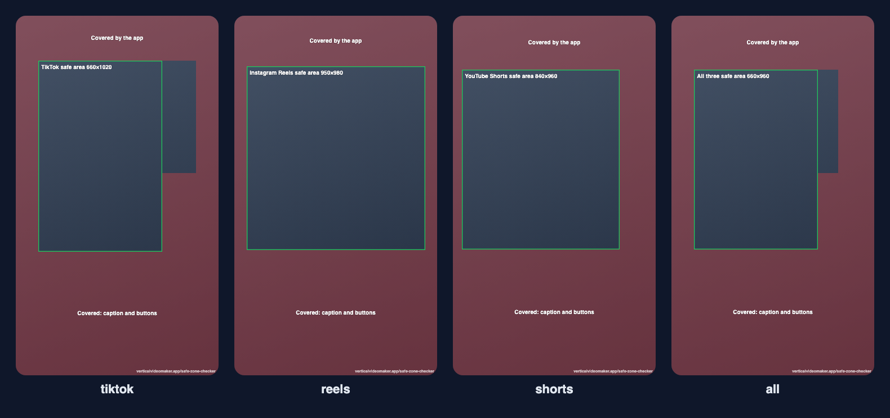

# vertical-safe-zones

Where TikTok, Instagram Reels and YouTube Shorts cover your 9:16 video with their buttons, captions and top bar. As **data**, a **tiny JS API** and **free overlay templates** (transparent PNG and SVG) you can drop on top of your video in any editor.



Want to check a frame without installing anything? Use the free **[safe zone checker](https://verticalvideomaker.app/safe-zone-checker/)**: drop an image or video and see each app's UI on top of it (runs in your browser, nothing is uploaded).

## Safe zones (1080×1920)

| Platform | Top | Bottom | Left | Right | Safe area |
|---|---|---|---|---|---|
| TikTok | 240 px | 660 px | 120 px | 300 px beside the buttons (120 px above them) | 660×1020 |
| Instagram Reels | 270 px | 670 px | 65 px | 65 px | 950×980 |
| YouTube Shorts | 288 px | 672 px | 48 px | 192 px | 840×960 |
| **All three** | 288 px | 672 px | 120 px | 300 px | **660×960** |

Taken from each platform's ad and creative templates, last checked November 2026. The apps don't publish exact numbers for regular posts, and a long caption pushes the bottom area higher, so treat these as minimums. Posting the same video everywhere? Use **All three**.

## Overlay templates

Download from [`templates/`](templates/). Each is 1080×1920 with a transparent background:

| File | What it shows |
|---|---|
| `tiktok-guide.png`, `reels-guide.png`, `shorts-guide.png`, `all-guide.png` | Covered areas shaded red, safe area outlined in green, labels |
| `tiktok-outline.png`, `reels-outline.png`, `shorts-outline.png`, `all-outline.png` | Only a dashed outline of the safe area |

SVG versions sit next to the PNGs.

**How to use one:** put the PNG on the top track above your video, scaled to fill the 9:16 frame. Keep text, subtitles, logos and faces inside the green box, then hide or delete the overlay track before you export.

- **CapCut:** Overlay → Add overlay → pick the PNG → stretch it to the full frame.
- **Premiere Pro / DaVinci Resolve / Final Cut:** import the PNG, place it on the highest video track over the whole timeline, and disable that track before rendering.

## JavaScript

```sh
npm install vertical-safe-zones
```

```js
import { safeArea, isSafe, coveredAreas, toSVG } from 'vertical-safe-zones';

safeArea('tiktok');                                // { x: 120, y: 240, width: 660, height: 1020 }
safeArea('all', { width: 720, height: 1280 });     // scaled: { x: 80, y: 192, width: 440, height: 640 }

isSafe({ x: 200, y: 1300, width: 400, height: 120 }, 'reels'); // false, it sits under the caption

coveredAreas('shorts');   // [{ name: 'top bar', x: 0, y: 0, width: 1080, height: 288 }, ...]
toSVG('all', { style: 'outline' });                // an overlay SVG string
```

Platforms: `'tiktok'`, `'reels'`, `'shorts'` and `'all'` (the area none of them cover). Sizes default to 1080×1920 and scale to any 9:16 frame you pass. The raw numbers are in [`zones.json`](zones.json) if you aren't using JavaScript.

Rebuild the templates (needs Chrome or chrome-headless-shell):

```sh
CHROME="/path/to/chrome" npm run templates
```

## Keeping it accurate

The apps change their layouts. If you notice a zone that's off, open an issue with a screenshot and the app version, or send a pull request that edits `zones.json` (and run `npm test`).

## Related

- [Safe zone checker](https://verticalvideomaker.app/safe-zone-checker/): check your own frame or video in the browser.
- [Vertical video sizes for every platform](https://verticalvideomaker.app/vertical-video-sizes/)
- [Vertical Video Maker](https://verticalvideomaker.app/): turn a landscape video into 9:16 in the browser, with blur fill or crop and smooth pan.

MIT licensed.
